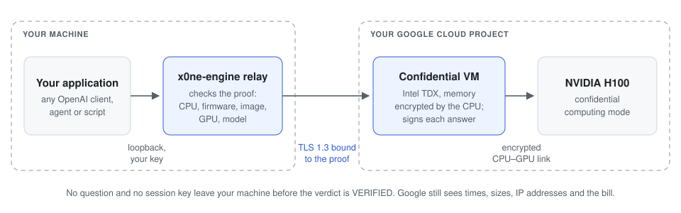

<h1 align="center"><picture><source media="(prefers-color-scheme: dark)" srcset="docs/assets/logo-dark.svg"></picture></h1>
<p align="center"><strong>Confidential AI inference. Preview.</strong></p>
<p align="center">
  <a href="https://github.com/x0ne-labs/x0ne-Engine/actions/workflows/ci.yml"></a>
  <a href="LICENSING.md"></a>
  <a href="rust-toolchain.toml"></a>
  <a href="docs/api.md"></a>
  <a href="#status"></a>
</p>
<p align="center">
  <a href="https://x0ne.co/engine">Website</a> ·
  <a href="docs/README.md">Documentation</a> ·
  <a href="docs/hardware-runs.md">Hardware runs</a> ·
  <a href="SECURITY.md">Security</a> ·
  <a href="CHANGELOG.md">Changelog</a>
</p>

x0ne Engine runs an open model inside a confidential virtual machine, in your own
Google Cloud account: Intel TDX with one NVIDIA H100, the only setup supported
today. Other clouds and your own TDX hosts are planned. This is a preview:
the cloud path does not start from this source tree yet, and every recorded
run used a test build ([Status](#status)). Your machine first asks
the VM for a hardware proof of what runs there, and checks it: the processor,
the firmware, the image, the GPU and the model. No question and no session key
go to the VM before that check says VERIFIED. Your applications then call it
like the OpenAI API, and every answer comes back with a receipt signed inside
the machine.

A recorded session, not a command to copy: its relay was a test build and its
reference was signed by the TEST key. With a relay built from this tree, `up`
stops before it asks for the cloud token and creates nothing (exit 95).

```console
$ x0ne-engine cloud up --project <project> --zone us-central1-a --model qwen3:32b \
    --reference /ref/x0ne-cvm-0.2.3.json --max-run 45m --max-cost 5.30 --auth stdin --yes
[1/5] Creating x0ne-engine-<id> in us-central1-a ... done (42 s)
[2/5] Waiting for boot and GPU setup ... done (0 s)
[3/5] Checking the hardware proof on THIS machine. No question and no session key have been sent yet.
      attestation document received; checking it on this machine, no question and no session key sent yet
      CPU   Intel TDX quote genuine, TCB UpToDate / QE UpToDate, TDX module identity matched …
      Firm  Google-endorsed firmware (MRTD c1ee9c16..., svn 2, signed C=USA, ST=WA, L=Kirkland, …
      Image x0ne-cvm 0.2.3 (reference signed 2026-10-18 by archive subkey with key ID …
      GPU   1 GPU(s), confidential computing on (NRAS token, nonce bound to this session)
      Link  TLS key and your session config are bound to this quote
      Model qwen3:32b, digest 745f026c... matches the catalog
      VERIFIED. Limits: x0ne-engine cloud status --limits
[4/5] Releasing the session key to the verified VM ...
      verdict VERIFIED; sending the session key over the attested channel
      key accepted; waiting for the TD to load the model
[5/5] OpenAI API on http://127.0.0.1:8478/v1
```

<sub>Abridged output of the 2026-10-18 run on Google Cloud (<code>a3-highgpu-1g</code>, one H100), as the client printed it: the project id is withheld, the line naming the VM's address, the key's path and the lines after the API's address are left out, and the lines over 100 characters are cut at "…" ([the run](docs/hardware-runs.md)). The two lines under `[3/5]` are given as this version prints them; that run printed "Nothing has been sent yet", which was wrong: the VM's metadata already held the session config (and, with `--nras-key-file`, the NRAS key). That run used a test build: the cloud path does not start from this tree yet (<a href="#status">Status</a>). It served the model on the engine before x0ne Core (<a href="CHANGELOG.md">CHANGELOG</a>).</sub>

## Highlights

- **Verified before any question is sent.** The relay on your machine checks the
  VM's proof: the TDX quote against Intel's collateral fetched live, the image's
  measurements, NVIDIA's verdict on the GPU and the model's digest. Until the
  verdict is VERIFIED, it only asks the VM for that proof; then it releases the
  session key. Verdict VERIFIED on 2026-10-18, 2026-10-25 and 2026-10-28 on
  the engine before x0ne Core, and on 2026-11-04 on x0ne Core, a TEST run
  ([hardware runs](docs/hardware-runs.md)).
- **Your cloud account, one VM per session.** `x0ne-engine cloud up` creates the
  confidential VM in your Google Cloud project: from a test build in every
  recorded run, not from this tree yet ([Status](#status)). The VM is created
  with a maximum run duration, `--max-run`, after which Google Cloud deletes
  it, and `x0ne-engine cloud down` deletes it sooner.
- **OpenAI-compatible, for text chats.** A client that sends plain text
  messages points at `http://127.0.0.1:8478/v1` with a local key. Tool calls
  get a 400 and a message whose `content` is an array of parts a 422;
  [docs/api.md](docs/api.md) lists what the API refuses.
- **Its own inference engine.** The model runs on x0ne Core, written for this
  project in Rust and CUDA: Qwen3 in BF16, on one GPU
  ([`x0ne-core`](x0ne-core/PROVENANCE.md)). On an H100, x0ne Core's own
  bench decoded `qwen3:8b` at 138.62 tokens a second after a 20-token prompt
  in CC mode (2026-11-03); through this
  Engine and its relay, 136.87 after a 58-token prompt, on the client's
  clock, in a TEST run on 2026-11-04 ([benchmarks](docs/benchmarks.md)).
- **A signed receipt for every answer.** Signed inside the VM, it names the TDX
  environment, the device that computed the answer (`cuda:0`: x0ne Core runs
  on GPU 0 only) and the model's digest.
- **Sealed by the caller, a prototype.** With `x0ne-sdk` (Rust, or wasm run
  in Node; not yet in a browser tab), your application checks the proof itself
  and seals its request to a key the proof binds; the relay passes it on
  without reading it. A release build of the SDK admits no image reference
  yet: it pins no release key and no log
  ([what is left](docs/sdk-e2e.md#what-is-left-in-order)).
  Ran on H100 on 2026-10-28, 2026-10-30, 2026-10-31, 2026-11-01 (the answer
  streamed sealed through the relay) and, on x0ne Core, 2026-11-04; the
  records are kept outside this repository
  ([hardware runs](docs/hardware-runs.md)).
- **Open source.** The server under AGPL-3.0, the SDK under Apache-2.0, built
  in Rust.

## How it works

<p align="center"></p>

1. `x0ne-engine cloud up` creates a confidential VM in your project, from a
   signed image reference.
2. The relay fetches the VM's proof and checks it on your machine. No question
   and no session key are sent before the verdict is VERIFIED.
3. It releases the session key over TLS 1.3 bound to that proof; the VM loads
   the model and checks its digest.
4. Your application calls the API on `127.0.0.1:8478`. Each answer carries a
   receipt signed in the VM.

## Status

> [!IMPORTANT]
> **Preview.** x0ne Engine is not end-to-end confidential yet, and the cloud
> path does not start from this source tree: no image is published and no
> release key is pinned. [What is left](#what-is-left) lists what is missing,
> in order.

### What is protected, and measured

- **The attested relay path.** On your machine, the relay
  (`x0ne-engine-proxy`) checks the TD's proof before it releases a key or
  sends a question: the TDX quote against Intel's collateral fetched live,
  the event log replayed to the image reference, NVIDIA's token for the GPU,
  the model digest. Questions then go over mutual TLS 1.3 bound to that
  quote, and each answer carries a receipt signed in the TD. Verdict VERIFIED
  on Google Cloud `a3-highgpu-1g` VMs, Intel TDX with one H100 in CC mode: on
  2026-10-18 the TD served `qwen3:32b` on the H100, on 2026-10-25
  `qwen3:0.6b`, its host's TCB judged on Intel's collateral of evaluation 22
  or later, and on 2026-10-28 `ministral3:14b` under the transparent TCB
  policy, which accepted a host that Intel's latest collateral rates
  OutOfDate and named the advisories Intel lists for it. Every run, the
  refused ones too, is in
  [docs/hardware-runs.md](docs/hardware-runs.md); the relay of these runs was
  a test build ([What is left](#what-is-left)). Those runs served their model
  on the engine before x0ne Core. This Engine on x0ne Core, from a pre-release
  commit (CHANGELOG, 0.2.0-beta.7): on 2026-11-04
  `up` refused the run's relay, a test build, before the token (exit 95, no
  VM created). Later that day, with the `up` of an earlier build (sources of
  2026-10-31), the image booted in a TD on an H100 in CC mode: verdict
  VERIFIED under the transparent TCB policy, RTMR1 and RTMR2 as predicted;
  the SDK sealed one question and verified the answer's receipt (its record
  is kept outside this repository); 36 answers
  streamed through the relay, every receipt verified by it
  ([results](bench/results/2026-11-04-h100-tdx-cc-core-e2e/)). A TEST
  measurement, the relay pinning a TEST key for the image reference and a
  TEST transparency log, not a release measurement: a release relay waits
  for the signing ceremony
  ([hardware runs](docs/hardware-runs.md), [What is left](#what-is-left)).
- **The client-sealed path.** With `x0ne-sdk`, the caller checks the TD's
  quote itself, in the relay's order, and seals its request to a key that
  quote binds (HPKE, framed as Oblivious HTTP); the TD serves the routes for
  it, `/v2/e2e/key` and `/v2/e2e/chat`, and the relay passes them on sealed.
  Run on such a VM on 2026-10-28, on 2026-10-30 with a key document of
  schema v2, on 2026-10-31 with RTMR0 pinned by the image reference, and on
  2026-11-01 with the answer also streamed sealed through the relay:
  the SDK, built for wasm32 and run in Node, verified the TD's key document
  itself (its TDX quote, and NVIDIA's verdict on the GPU, which the
  document carries), sealed one question, opened the answer and verified
  its receipt; a sealed request with one bit changed got 400, and under the
  strict TCB policy the SDK refused that host (76), as the relay does. On
  each of those days, a word written only in the question was in none of
  the bytes the SDK exchanged with the relay, nor in the relay's logs or
  state. Each run took its image reference under a test key and a test log,
  through a relay built for tests ([What is left](#what-is-left)). Before
  them, tested from the SDK through the TD's own server code, on synthetic
  TDX evidence, with a carrier that records every byte it moves: neither the
  question nor the answer is in any of them, where the same recorder finds
  both on the plain route, and a changed quote, key, image or event log is
  refused at its step. The SDK's quote check also accepts the real quote of
  the 2026-10-18 run, replayed offline with that run's event log and
  reference, and refuses each part of it altered
  ([docs/sdk-e2e.md](docs/sdk-e2e.md)).

### What is left

Today, this is **not end-to-end
confidential**, and the cloud path does not start from this source tree: its
relay pins no archive key (exit 99) and no transparency log (exit 100), and no
image is published.

- On the relay path, the application you type into speaks plain HTTP to the
  relay on your machine: the attested channel starts at the relay, not at
  the application ([docs/cloud.md](docs/cloud.md) says where the text is in
  clear, segment by segment).
- The client-sealed path ran on TDX hardware on 2026-10-28, 2026-10-30,
  2026-10-31, 2026-11-01 and 2026-11-04, the last on x0ne Core. On
  2026-10-30 the SDK verified a real TD's key document of schema v2, which carries the GPU's evidence and NVIDIA's
  verdict on it, and opened one sealed answer; on 2026-10-31 it pinned
  RTMR0 as well; on 2026-11-01 it opened the same answer as a sealed stream
  through the relay, the relay opening none of its frames; on 2026-11-04 it sealed one question and verified the answer's
  receipt. Five runs of one question each, under a TEST archive key and a
  TEST transparency log, through a relay built with debug assertions
  ([docs/hardware-runs.md](docs/hardware-runs.md)); the SDK ran in Node,
  not in a browser tab, and a release build of the SDK
  admits no image reference yet. Since 2026-10-31 the SDK keeps the log's
  last verified checkpoint, as the caller's memory, and refuses a log that
  forks, goes back, or grows without a consistency proof (tested on the
  TEST log, not on hardware; [docs/sdk-e2e.md](docs/sdk-e2e.md), "The
  log's memory").
- The padding hides an answer's length from the network, not from the VM's
  host: the computation stops when the generation ends, so the VM's CPU time
  and the GPU's work follow the length, and a host that reads them would
  count the tokens. Deduced, not measured in CC mode (the
  [threat model](x0ne-infer/THREAT_MODEL.md), row "Host reading an answer's
  length from the computation").
- The VERIFIED runs used a relay built with debug assertions, pinning a TEST
  archive key (and, since 2026-10-25, a TEST transparency log).
- RTMR0 (the host's TD HOB, Secure Boot variables, ACPI tables and boot
  variables, with the configuration volume of Google's firmware) is pinned
  by the image reference since 2026-10-31 (`rtmr0.policy` `gce-endorsed`,
  the only policy the relay and the SDK admit; a `report` reference is
  refused, 104), to the events of one boot, not audited; no published
  reference pins it yet, so none published is admitted until one does; the
  revocation of NVIDIA's signing chain is judged from the OCSP responses the
  TD staples, and no TD staples them yet, so every verdict says so; a
  revocation of the archive key reaches you only with a new release.

What we intend, in this order and without a date
([docs/sdk-e2e.md](docs/sdk-e2e.md#what-is-left-in-order) details each step):
the sealed stream opened in a browser tab (the SDK's browser build streams
since 2026-10-31 and ran on hardware from Node on 2026-11-01, not from a
tab); the TD fetching the OCSP responses of
NVIDIA's signing chain (the verifier judges them since 2026-10-31, on
synthetic responders); a third-party relay; for the cloud
path, the archive key's signing ceremony, a public transparency log and a
published image; signed distribution and an external audit.

### What no TEE protects

As with any trusted execution environment:

- physical attacks on memory (TEE.fail, DDR5 interposers) and side channels
  (TDXRay reads the tokenizer's accesses);
- a compromise of Intel's, NVIDIA's or Google's roots;
- availability, and what the traffic shows: Google can stop the VM, and sees
  times, sizes, IP addresses and the bill;
- on Hopper, CPU and GPU evidence are tied by the TD's software, not by the
  hardware;
- the code of the image a verdict names, and the model's behaviour: a verdict
  says which image runs, not that it is free of flaws.

[docs/limitations.md](docs/limitations.md) and the
[threat model](x0ne-infer/THREAT_MODEL.md) give the whole list.

## Install

Each GitHub release, from v0.2.0-beta.7, carries the client binaries
prebuilt: `x0ne-engine`, `x0ne-engine-cloud` and `x0ne-engine-proxy`, for
Linux on x86_64 with glibc. The server, `x0ne-infer`, runs in the
confidential VM and ships in no release asset. Installing the client
changes nothing in [Status](#status): x0ne Engine is not end-to-end
confidential yet.

```sh
curl --proto '=https' --tlsv1.2 -fsSL https://raw.githubusercontent.com/x0ne-labs/x0ne-Engine/main/install.sh | sh
```

`make install-check` runs `install.sh` against fake releases served on
127.0.0.1, as an ordinary user without network, in Debian 13, Ubuntu 24.04,
Fedora 43 and Alpine 3 containers. What the script does, and nothing else:

- installs the release named on its `VERSION` line (0.2.0-beta.7);
  `--version <v>` or `X0NE_ENGINE_VERSION` picks another
  (`curl ... | sh -s -- --version <v>`);
- stops before any download on an OS other than Linux, a CPU other than
  x86_64, or a system without the glibc loader (Alpine, musl);
- downloads `SHA256SUMS` and `SHA256SUMS.sig` from the release, then
  `x0ne-engine-x86_64-unknown-linux-gnu.tar.gz`, with curl, over https
  only: an http mirror or a redirect to http is refused. It makes no other
  request;
- verifies `SHA256SUMS.sig` with `ssh-keygen -Y verify` (OpenSSH 8.1 or
  later) against the release key written in the script: the maintainer's
  SSH key, `SHA256:+8onkVcMPL3D/8vOL/xn5TrHLGWNYOKWbWIMwM+BPtE`, which
  signs the release tags too. It refuses if the signature is missing or
  does not verify, if `ssh-keygen` is missing or older than 8.1, or if the
  first line of `SHA256SUMS` names another release than the one asked for.
  No variable or option changes the key or skips the check; nothing is
  downloaded, extracted or run before it;
- refuses to install if the archive is not listed in `SHA256SUMS`, or if
  its SHA-256 differs;
- if the GitHub CLI 2.56 or later is installed and logged in, also runs
  `gh attestation verify --signer-workflow` and refuses on failure;
  otherwise says the build provenance is not checked, and why;
- runs the new `x0ne-engine --version` in the install directory before it
  replaces anything: a binary that does not run there leaves the previous
  install in place;
- copies the three binaries to `~/.local/bin` (`X0NE_ENGINE_INSTALL_DIR` to
  change it). No `sudo`; no shell file is edited.

`sh install.sh --uninstall` removes the three binaries and keeps the model
cache. A pipe into `sh` runs whatever the server sends: to read the script
first, download it with `curl -fsSLO`, read it, then run `sh install.sh`.

### Debian and Ubuntu package

The release also carries `x0ne-engine_amd64.deb`: the same three binaries
in `/usr/bin`, byte for byte (the release workflow checks it). It installs
with `dpkg -i`, runs and removes in Debian 13 and Ubuntu 24.04 containers
(`ENGINE_DEB=<file> make install-check`). It needs `libc6`, `libstdc++6`,
`libgcc-s1` and `ca-certificates`.

The block below stops at the first command that fails: in a new
directory, it downloads `SHA256SUMS` and its signature, verifies the
signature as `install.sh` does, checks that the list is the one of this
release and names the `.deb`, and only then downloads the `.deb`, checks
its SHA-256, and runs `dpkg` as root. It needs curl and `ssh-keygen`
(`openssh-client`); `ci/tests/installer.sh` replays it.

```sh
(
  set -eu
  tag=v0.2.0-beta.7
  url=https://github.com/x0ne-labs/x0ne-Engine/releases/download/$tag
  dir=$(mktemp -d)
  cd "$dir"
  for f in SHA256SUMS SHA256SUMS.sig; do
    curl --proto '=https' --proto-redir '=https' --tlsv1.2 -fsSL -o "$f" "$url/$f"
  done
  echo 'dev@x0ne.co namespaces="x0ne-engine-release" ssh-ed25519 AAAAC3NzaC1lZDI1NTE5AAAAICYdHwVN3y1azWxmVmm7sMQOI/BJGN2YI7qpGiQ0+4/Y' > allowed_signers
  ssh-keygen -Y verify -f allowed_signers -I dev@x0ne.co -n x0ne-engine-release -s SHA256SUMS.sig < SHA256SUMS
  first=$(head -n 1 SHA256SUMS)
  test "$first" = "# x0ne-Engine $tag" || { echo "SHA256SUMS is not the list of $tag" >&2; exit 1; }
  line=$(awk '$2 == "x0ne-engine_amd64.deb"' SHA256SUMS)
  test -n "$line" || { echo "x0ne-engine_amd64.deb is not in SHA256SUMS" >&2; exit 1; }
  printf '%s\n' "$line" > asset.sha256
  curl --proto '=https' --proto-redir '=https' --tlsv1.2 -fsSL -o x0ne-engine_amd64.deb "$url/x0ne-engine_amd64.deb"
  sha256sum -c asset.sha256
  sudo dpkg -i "$dir/x0ne-engine_amd64.deb"
)
```

### Verify a release by hand

The same steps, without installing: set `asset` to
`x0ne-engine_amd64.deb` or `install.sh` for the other files `SHA256SUMS`
lists. The asset is downloaded only once the signature and the list
verify.

```sh
(
  set -eu
  tag=v0.2.0-beta.7
  asset=x0ne-engine-x86_64-unknown-linux-gnu.tar.gz
  url=https://github.com/x0ne-labs/x0ne-Engine/releases/download/$tag
  dir=$(mktemp -d)
  cd "$dir"
  for f in SHA256SUMS SHA256SUMS.sig; do
    curl --proto '=https' --proto-redir '=https' --tlsv1.2 -fsSL -o "$f" "$url/$f"
  done
  echo 'dev@x0ne.co namespaces="x0ne-engine-release" ssh-ed25519 AAAAC3NzaC1lZDI1NTE5AAAAICYdHwVN3y1azWxmVmm7sMQOI/BJGN2YI7qpGiQ0+4/Y' > allowed_signers
  ssh-keygen -Y verify -f allowed_signers -I dev@x0ne.co -n x0ne-engine-release -s SHA256SUMS.sig < SHA256SUMS
  first=$(head -n 1 SHA256SUMS)
  test "$first" = "# x0ne-Engine $tag" || { echo "SHA256SUMS is not the list of $tag" >&2; exit 1; }
  line=$(awk -v f="$asset" '$2 == f' SHA256SUMS)
  test -n "$line" || { echo "$asset is not in SHA256SUMS" >&2; exit 1; }
  printf '%s\n' "$line" > asset.sha256
  curl --proto '=https' --proto-redir '=https' --tlsv1.2 -fsSL -o "$asset" "$url/$asset"
  sha256sum -c asset.sha256
  echo "verified: $dir/$asset"
)
```

With gh 2.56 or later, the build provenance too, in that directory: the
release workflow attests every file `SHA256SUMS` lists.

```sh
gh attestation verify x0ne-engine-x86_64-unknown-linux-gnu.tar.gz --repo x0ne-labs/x0ne-Engine \
  --signer-workflow x0ne-labs/x0ne-Engine/.github/workflows/release.yml
```

Other platforms build from source, below.

## Quick start

Replayed on Debian 13 (trixie) in a fresh `debian:trixie-slim` container, as
an ordinary user (the image has no `sudo`: the `apt-get` line ran as root):
the first block with the network, the second without.

```sh
sudo apt-get update && sudo apt-get install build-essential pkg-config git curl ca-certificates perl
curl --proto '=https' --tlsv1.2 -sSf https://sh.rustup.rs | sh -s -- -y --profile minimal --default-toolchain none
. "$HOME/.cargo/env"
# in the source tree:
rustup toolchain install
cargo fetch --locked
```

`rustup toolchain install` installs the compiler `rust-toolchain.toml` pins
(1.98.1, with clippy and rustfmt); `cargo fetch` is the last step that needs
the network.

```sh
cargo test --locked -p x0ne-infer
cargo build --locked --release -p x0ne-infer --bin x0ne-infer --bin x0ne-engine --bin x0ne-engine-proxy
target/release/x0ne-infer --version
target/release/x0ne-infer --model-dir /tmp/none; echo "exit $?"
target/release/x0ne-engine catalog
```

What to expect:

- `cargo test` passes 1374 tests and ignores 32 (they need model files, a
  CUDA device or a wasm build, or print timings), measured on 2026-11-07 in
  that container on Linux 6.12.115. No TEE, GPU, CUDA toolkit
  or network is needed: x0ne Core builds with the `cuda` feature only.
  `perl` with its `Digest::SHA` is needed (`scripts/pin-archive-key.sh` and
  `scripts/pin-transparency-log.sh` run in the tests). The two blocks fill
  about 19 GiB of `target/` with Cargo's defaults (2026-11-07, same
  container), 15.6 GiB in the CI image (2026-11-04, Debian 12, which sets
  `CARGO_INCREMENTAL=0`).
- `x0ne-infer` refuses to start outside a verified TEE and exits 87: this
  version's measurements file has TEST provenance, which a release build
  refuses first ([docs/running.md](docs/running.md)).
- `x0ne-engine catalog` lists the five models the catalog pins, all
  Qwen3: `qwen3:0.6b`, `qwen3:1.7b`, `qwen3:8b`, `qwen3:14b` and
  `qwen3:32b`. On hardware, this Engine on x0ne Core has served `qwen3:8b`
  only, in one TEST run on 2026-11-04
  ([hardware runs](docs/hardware-runs.md)).
- `x0ne-engine cloud …` needs a fourth binary next to `x0ne-engine`,
  `x0ne-engine-cloud`, which the release archive and the `.deb` carry. From
  source: `cargo build --locked --release -p x0ne-engine-cloud --bin
  x0ne-engine-cloud`. Without it, the command exits 91 and says where it
  looked.
- The binaries keep their symbols and line tables: `x0ne-infer` is about
  89.6 MB, measured in the CI image (Debian 12).
  `ci/strip-release.sh <debug dir> <binary>...` moves them to debug files
  (`x0ne-infer` 9.9 MB), as the packages do; or keep the size
  ([docs/ci-local.md](docs/ci-local.md#built-from-source)).

On a TDX guest, [docs/running.md](docs/running.md) gives the server's
requirements and flags.

## The crates

| Crate | What it does |
|---|---|
| [`x0ne-infer`](x0ne-infer) | The inference server, which serves a model only inside a verified TEE: no Intel TDX proof (and, by default, no NVIDIA GPU proof), no key read, no socket bound. Also the `x0ne-engine` command and its relay, `x0ne-engine-proxy`. |
| [`x0ne-confidential`](x0ne-confidential) | The attestation vocabulary the other crates share. |
| [`x0ne-engine-cloud`](x0ne-engine-cloud) | The cloud lifecycle behind `x0ne-engine cloud`: quote, create, watch and delete one confidential GPU VM per session. It holds the cloud token; the relay holds the questions. |
| [`x0ne-sdk`](x0ne-sdk) | The caller's side, a prototype: checks the proof and seals requests to the VM. |
| [`x0ne-ohttp`](x0ne-ohttp) | A prototype that no x0ne binary uses. |
| [`x0ne-core`](x0ne-core) | x0ne Core, the engine `x0ne-infer` runs the model on, in a workspace of its own (its kernels need `nvcc`): `x0ne-core-kernels`, CUDA kernels compiled ahead of time, and `x0ne-core-runtime`, both copied unchanged from x0ne Core ([`PROVENANCE.md`](x0ne-core/PROVENANCE.md)). Linked by `x0ne-infer` with the `cuda` feature only. |

## Documentation

| Read | For |
|---|---|
| [docs/verification.md](docs/verification.md) | what a verified verdict proves, receipts, sealed weights, the CPU and GPU halves |
| [docs/limitations.md](docs/limitations.md) | what is not protected, and what is out of scope |
| [docs/hardware-runs.md](docs/hardware-runs.md) | each run on real hardware, and what never ran on it |
| [FEATURES.md](FEATURES.md) | every feature with its level: measured on hardware (and since which run), tested, prototype, planned, replaced |
| [docs/pinning.md](docs/pinning.md) | measurements, pinning RTMRs, Google's firmware |
| [docs/attested-channel.md](docs/attested-channel.md) | the cloud path's checks, made on your machine; does not start from this tree yet |
| [docs/cloud.md](docs/cloud.md) | `x0ne-engine cloud`: one confidential GPU VM per session; does not start from this tree yet |
| [docs/api.md](docs/api.md) | the OpenAI-compatible API, what it refuses, the token ceiling |
| [docs/running.md](docs/running.md) | building and running the server |
| [docs/related-work.md](docs/related-work.md) | related work, and why not vLLM |
| [docs/testing.md](docs/testing.md) | the tests and their fixtures |
| [x0ne-infer/THREAT_MODEL.md](x0ne-infer/THREAT_MODEL.md) | the threat model and the known attacks |

[docs/README.md](docs/README.md) lists the documents of `docs/`.

## x0ne OS

The confidential VM image (`x0ne-cvm`) and its signed image reference come
from x0ne OS, whose repository is not public yet: <https://x0ne.co/x0ne-os/>.

## Contributing

[CONTRIBUTING.md](CONTRIBUTING.md) says what a change must pass before review, and [docs/BRANCHING.md](docs/BRANCHING.md) how branches and releases work.

## Security

Report a vulnerability privately, as [SECURITY.md](SECURITY.md) explains: we answer within 72 hours. Please do not open a public issue for it.

## License

The server is under the GNU Affero General Public License, version 3 only
(AGPL-3.0-only), with an additional permission to combine it with NVIDIA's
CUDA and driver libraries: see [LICENSE](LICENSE). What an application builds in,
`x0ne-sdk`, `x0ne-confidential` and `x0ne-ohttp`, is under Apache-2.0, each
crate with its own `LICENSE`. [LICENSING.md](LICENSING.md) maps every crate,
and [NOTICE](NOTICE) credits third parties.

A commercial license is for whoever the AGPL does not fit: a company that
modifies the server and lets others use it over a network without offering
them the source of its changes, or that ships the server inside a product
under other terms. Write to contact@x0ne.co.
